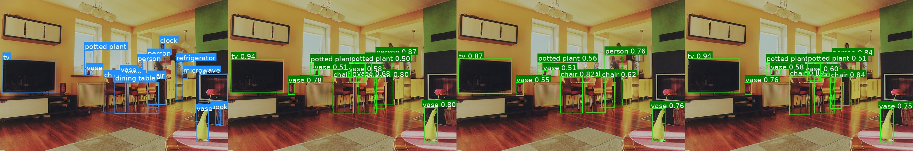
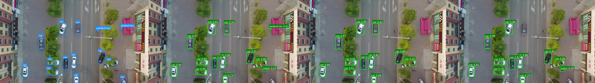

# Fully Quantized LW-DETR

End-to-end quantization workflows for the [LW-DETR](https://github.com/Atten4Vis/LW-DETR) object detector.

This repository takes an LW-DETR checkpoint through the complete deployment path:

```text
float checkpoint -> quantization-ready fine-tuning -> PTQ calibration -> QAT -> evaluation -> ONNX/TensorRT
```

The quantized graph includes the ViT backbone, multi-scale projector, transformer encoder and decoder, and prediction heads. The goal is a reproducible, fully quantized configuration rather than a collection of independent per-layer experiments.

This work accompanies the arXiv paper [Enabling Fully Integer-Only Inference for Lightweight Detection Transformers](https://arxiv.org/abs/2607.24981). The implementation is based on the official LW-DETR repository.

<p align="center">
  
</p>

## What is included

| Workflow | Entry point | Main output |
| --- | --- | --- |
| Fine-tuning | `setup/finetune/run.sh` | `checkpoint.pth` |
| PTQ calibration | `setup/ptq/run.sh` | `checkpoint_calibrated.pth` |
| QAT | `setup/qat/run.sh` | training checkpoints |
| Evaluation | `setup/eval/run.sh` | COCO metrics in `eval.log` |
| Image inference | `setup/infer/run.sh` | annotated image and predictions |
| ONNX/TensorRT export | `setup/export/run.sh` | `.onnx` and optional `.engine` |

The maintained workflow wrappers support `tiny`, `small`, and `medium`.

## 1. Installation

The development environment was Python 3.8.19, PyTorch 1.13, torchvision 0.14, and CUDA 11.6. A GPU is expected for training, calibration, QAT, and TensorRT export.

```bash
git clone <company-repository-url>
cd LW-DETR

conda create -n lwdetr python=3.8.19 -y
conda activate lwdetr

# Install the PyTorch build matching the machine's CUDA installation first.
# Example for the original CUDA 11.6 environment:
pip install torch==1.13.1+cu116 torchvision==0.14.1+cu116 \
  --extra-index-url https://download.pytorch.org/whl/cu116

pip install -r requirements.txt
```

The main implementation uses the PyTorch deformable-attention code under `models/ops`; no local extension build is required. `models/ops1` contains a legacy CUDA extension and is not part of the standard setup.

For ONNX/TensorRT work, install the additional deployment packages in an environment with a compatible TensorRT installation:

```bash
pip install -r deploy/requirements.txt
```

Check the command-line entry point:

```bash
python main.py --help
```

## 2. Prepare data and checkpoints

COCO and custom COCO-format datasets use this layout:

```text
DATASET_ROOT/
├── train2017/
├── val2017/
└── annotations/
    ├── instances_train2017.json
    └── instances_val2017.json
```

Use `DATASET_FILE=coco` for COCO. Use `DATASET_FILE=custom_coco` for another dataset with COCO-format annotations; the class-head size is inferred from its category IDs.

Store checkpoints anywhere outside Git and pass their exact paths to the workflow scripts. A convenient local convention is:

```text
pretrain_weights/
└── coco/
    └── tiny/
        └── LWDETR_tiny_60e_coco.pth
```

`pretrain_weights/`, `data/`, and `output/` are ignored by Git. They are runtime assets and are not delivered by this repository.

For VisDrone conversion and class-ID details, see the [extended setup guide](setup/README.md#custom-coco-format-datasets).

## 3. Quick start: run inference

The shortest validation path uses a quantization-ready (`qr`) or QAT checkpoint:

```bash
bash setup/infer/run.sh \
  tiny \
  qat \
  /path/to/lwdetr_tiny_qat.pth \
  demo/images/objects.jpg
```

The default output is `output/infer/tiny_qat/objects/`. Use `DEVICE=cpu` only when the selected model operations and checkpoint support CPU execution.

For a custom COCO-format checkpoint:

```bash
DATASET_FILE=custom_coco \
bash setup/infer/run.sh tiny qat /path/to/custom_qat.pth /path/to/image.jpg
```

## 4. Tutorial: float model to fully quantized model

Run all commands from the repository root. The examples below use tiny LW-DETR and COCO; replace the paths without changing the workflow order.

### Step A — create a quantization-ready float checkpoint

Start with a float checkpoint already trained for the target dataset. `EASY_QUANTIZE=true` selects the quantization-friendly float graph. For COCO, retain the existing class heads:

```bash
DATASET_FILE=coco \
EASY_QUANTIZE=true \
KEEP_CLASS_HEAD=true \
CLASS_HEAD_WARMUP_EPOCHS=0 \
OUTPUT_DIR=output/coco_tiny_easy_quant \
bash setup/finetune/run.sh \
  tiny \
  /path/to/COCO \
  /path/to/LWDETR_tiny_60e_coco.pth
```

Expected output: `output/coco_tiny_easy_quant/checkpoint.pth`, periodic checkpoints, and `log.txt` after at least one epoch finishes. Console output is captured by your terminal or Slurm `-o` file.

To adapt a COCO model to a dataset with different classes, use `DATASET_FILE=custom_coco` and omit `KEEP_CLASS_HEAD=true`. The runner replaces the classification heads and trains them for a short warm-up before unfreezing the detector.

### Step B — calibrate with PTQ

```bash
NPROC_PER_NODE=1 \
CUDA_VISIBLE_DEVICES=0 \
DATASET_FILE=coco \
OUTPUT_DIR=output/coco_tiny_ptq \
bash setup/ptq/run.sh \
  tiny \
  /path/to/COCO \
  /path/to/checkpoint
```

The default calibration observes 500 batches and then evaluates the model. Expected checkpoint:

```text
output/coco_tiny_ptq/checkpoint_calibrated.pth
```

Useful overrides include `CALIB_BATCHES`, `ACT_OBSERVER`, `ACT_PERCENTILE`, and `SOFTMAX_M_SAFE_GUARD`. Their accepted values are documented in the [PTQ reference](setup/README.md#fully-quantized-ptq-and-qat).

### Step C — train with QAT

Resume from the calibrated checkpoint and freeze its observer statistics:

```bash
NPROC_PER_NODE=1 \
CUDA_VISIBLE_DEVICES=0 \
DATASET_FILE=coco \
SKIP_PRETRAIN=true \
QAT_FREEZE_OBSERVERS=true \
OUTPUT_DIR=output/coco_tiny_qat \
bash setup/qat/run.sh \
  tiny \
  /path/to/COCO \
  /path/to/ptq/checkpoint
```

Set `TENSORBOARD=true` to write TensorBoard events. Set `RESUME_OPTIMIZER=true` only when continuing the same QAT run with a compatible optimizer state.

### Step D — evaluate one exact checkpoint

Choose the variant that matches how the checkpoint was produced:

| Variant | Model constructed by evaluator |
| --- | --- |
| `original` | upstream float graph |
| `qr` | quantization-ready float graph |
| `ptq` | quantized graph with calibrated weights/statistics |
| `qat` | quantized graph after QAT |

```bash
NPROC_PER_NODE=1 \
CUDA_VISIBLE_DEVICES=0 \
DATASET_FILE=coco OUTPUT_DIR=output/eval_tiny_qat \
bash setup/eval/run.sh \
  tiny \
  qat \
  /path/to/COCO \
  /path/to/checkpoint
```

The evaluator writes `eval.log` and `eval.pth` under
`output/eval_tiny_qat/`. It deliberately requires an exact checkpoint
path so a filename convention cannot silently select the wrong model.

### Step E — export for deployment

Export an ONNX model from a QAT checkpoint:

```bash
NPROC_PER_NODE=1 \
CUDA_VISIBLE_DEVICES=0 \
QUANT=true \
OUTPUT_DIR=output/export_tiny_qat \
bash setup/export/run.sh \
  tiny \
  /path/to/COCO \
  /path/to/checkpoint \
  --simplify
```

Expected output: `output/export_tiny_qat/inference_model.onnx` and, when simplification succeeds, `inference_model.sim.onnx`. Add `--trt` to build a TensorRT engine. Export compatibility depends on the installed ONNX, CUDA, and TensorRT versions.

### Optional — adapt COCO to VisDrone first

For a custom dataset such as VisDrone, first fine-tune the original COCO
checkpoint on the custom COCO-format annotations. This creates the float
VisDrone checkpoint that becomes the starting point for Step A:

```bash
DATASET_FILE=custom_coco \
EASY_QUANTIZE=false \
OUTPUT_DIR=output/visdrone_medium_finetune_from_coco_cosine \
EPOCHS=200 \
LR_SCHEDULER=delayed_cosine \
LR_DECAY_START_EPOCH=40 \
LR_MIN_FACTOR=0.01 \
LR=1e-4 \
LR_ENCODER=1e-5 \
LR_CLASS_HEAD=2e-4 \
CLASS_HEAD_WARMUP_EPOCHS=5 \
BATCH_SIZE=2 \
bash setup/finetune/run.sh \
  medium \
  /path/to/VisDrone2019-DET-coco \
  /path/to/LWDETR_medium_60e_coco.pth
```

After this finishes, repeat Steps A through E with
`DATASET_FILE=custom_coco`, the VisDrone dataset path, and
`output/visdrone_medium_finetune_from_coco_cosine/checkpoint.pth` as the
starting checkpoint.

## 5. Results and reproducibility

Evaluation reports standard COCO mAP metrics.

| Model | Setting | Precision | Integer-only | Size (MB) | BOPs (T) | mAP | APS | APM | APL |
| --- | --- | --- | :---: | ---: | ---: | ---: | ---: | ---: | ---: |
| Tiny | LW-DETR | FP32 | no | 45.98 | 11.52 | 42.6 | 22.7 | 47.4 | 60.0 |
| Tiny | QR-LW-DETR | FP32 | no | 46.49 | 11.54 | 42.0 | 22.1 | 46.5 | 58.8 |
| Tiny | PTQ | 8/8/16 | yes | 12.85 | 0.89 | 36.0 | 17.7 | 40.5 | 51.5 |
| Tiny | QAT | 8/8/16 | yes | 12.85 | 0.89 | 37.9 | 19.0 | 42.1 | 54.5 |
| Small | LW-DETR | FP32 | no | 55.54 | 17.06 | 48.0 | 26.8 | 52.5 | 65.6 |
| Small | QR-LW-DETR | FP32 | no | 56.05 | 17.10 | 46.4 | 25.3 | 50.8 | 64.0 |
| Small | PTQ | 8/8/16 | yes | 17.21 | 1.32 | 41.6 | 21.7 | 46.5 | 57.4 |
| Small | QAT | 8/8/16 | yes | 17.21 | 1.32 | 43.7 | 23.6 | 47.8 | 60.1 |
| Medium | LW-DETR | FP32 | no | 107.73 | 43.84 | 52.5 | 32.7 | 57.6 | 70.6 |
| Medium | QR-LW-DETR | FP32 | no | 108.23 | 43.88 | 50.8 | 30.2 | 55.5 | 68.8 |
| Medium | PTQ | 8/8/16 | yes | 30.44 | 3.04 | 44.0 | 24.9 | 48.4 | 60.6 |
| Medium | QAT | 8/8/16 | yes | 30.44 | 3.04 | 47.1 | 26.5 | 51.5 | 64.6 |

Qualitative examples:

**COCO**



**VisDrone**



Before external release, tie each row to the exact checkpoint hash, dataset version, GPU, CUDA, PyTorch, and TensorRT versions where relevant.

The original LW-DETR architecture and upstream results are summarized in [figures/LW_DETR_main_results.pdf](figures/LW_DETR_main_results.pdf).

## 6. Repository map

```text
LW-DETR/
├── main.py              # training, calibration, QAT, evaluation, export CLI
├── engine.py            # training and COCO evaluation loops
├── models/              # float LW-DETR implementation
├── quant_models/        # quantized and fake-quantized implementation
├── datasets/            # COCO, custom COCO, and Objects365 loaders
├── workflows/           # Python orchestration split out of main.py
├── setup/               # maintained user-facing workflow wrappers
├── deploy/              # ONNX/TensorRT utilities and benchmarks
├── demo/                # single-image inference and visualization
├── util/                # shared utilities and dataset conversion
├── scripts/             # upstream/legacy experiment commands
└── scripts_pretrain/    # Objects365 pretraining commands
```

New users should start with `setup/`. The commands in `scripts/` preserve experiment configurations but contain machine- and GPU-count assumptions and are not the recommended public interface.

## License and citation

The code is released under the [Apache License 2.0](LICENSE).

If this repository is useful for your work, please cite:

```bibtex
@misc{le2026enablingfullyintegeronlyinference,
      title={Enabling Fully Integer-Only Inference for Lightweight Detection Transformers}, 
      author={Thanh Cong Le and Michal Szczepanski and Martyna Poreba},
      year={2026},
      eprint={2607.24981},
      archivePrefix={arXiv},
      primaryClass={cs.CV},
      url={https://arxiv.org/abs/2607.24981}, 
}
```

Also cite the upstream LW-DETR project when using the base detector.

## Acknowledgements

This project builds on LW-DETR, Group DETR, ViTDet, Deformable DETR, Conditional DETR, AlignDETR, CAE, I-ViT, and I-Segmenter. We thank their authors for releasing their work.
